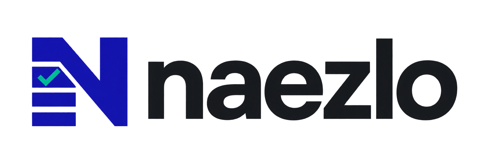

<h1 align="center">
  
</h1>

This is a todolist app. Will be built in public.

# v1 Features

- Organizations
- Multiple users per Organization
- Multiple projects per organization
- Per project, multiple lists
- ACL Per project
- ACL Per list
- New user gets a default organization, does not have to be a business per se, it's just there in case user wants to expand
- Allow AI agents to use lists
- Mark a list as AI-only, human only or mixed (default if AI is onboarded)
- Assign an item to a person or an agent; a list can require assignment, so that only the
  assignee completes an item and a person and an agent never do the same work
- Easy MCP setup with instructions for claude, codex
- Auditlog per project, per list
- User interface, Oauth login (at least Google)

# Out of scope for v1

- Billing

# Technical requirements

- Use FastAPI
- Use uv
- Use recent python

# Local setup

You need [uv](https://docs.astral.sh/uv/) (it installs Python 3.14 itself), Docker with Compose,
and Node.js with npm for the frontend.

```sh
uv sync                              # Python dependencies in .venv
cp .env.example .env                 # configuration; the defaults work for local development
docker compose up -d                 # PostgreSQL 18 on localhost:5435
docker compose ps                    # wait until it says "healthy"
uv run alembic upgrade head          # create the tables
npm --prefix frontend install        # frontend dependencies
```

`docker compose up -d` creates three databases: `todolist` (development), `todolist_test` (pytest)
and `todolist_e2e` (the browser tests). Only the first one is migrated by hand; the tests migrate
their own. After pulling changes, run `uv sync`, `uv run alembic upgrade head` and
`npm --prefix frontend install` again.

To sign in without a Google account, set `DEV_LOGIN=true` in `.env`: the login page then has a form
that signs you in as any email address. It is for local development only, and the app refuses to
start with it when `ENVIRONMENT=production`.

# Running the app

For development, run the backend and the Vite dev server next to each other:

```sh
uv run uvicorn todolist.app:create_app --factory --reload   # API on http://localhost:8000
npm --prefix frontend run dev                               # UI on http://localhost:5173
```

Set `PUBLIC_BASE_URL=http://localhost:5173` in `.env` and open http://localhost:5173. The dev
server passes the backend's paths (`/api`, `/mcp`, the OAuth endpoints) on to port 8000.

Without the dev server, build the frontend once and let the backend serve it:

```sh
npm --prefix frontend run build      # writes frontend/dist
uv run uvicorn todolist.app:create_app --factory
```

Leave `PUBLIC_BASE_URL=http://localhost:8000` and open http://localhost:8000. This is also the
production setup, with `ENVIRONMENT=production`, a real `SESSION_SECRET` (`openssl rand -hex 32`),
`DEV_LOGIN=false` and `PUBLIC_BASE_URL` set to the address people use. `GET /healthz` is the health
check.

# Running all checks

PostgreSQL must be running (`docker compose up -d`). The browser tests need Chromium once per
machine: `npx --prefix frontend playwright install chromium`.

```sh
uv run ruff check                    # lint
uv run ruff format --check           # formatting
uv run pyright                       # types
uv run pytest                        # backend tests, on the database todolist_test
npm --prefix frontend run lint       # eslint
npm --prefix frontend run typecheck  # tsc
npm --prefix frontend run test       # vitest
npm --prefix frontend run e2e        # Playwright: builds the frontend and starts its own backend
```

The browser tests start a backend on port 8765 with the database `todolist_e2e`, which is emptied
at every run. After a change to an API route or model, run `npm --prefix frontend run gen:api` to
update the frontend's generated types.

# Configuring Google login

1. In the [Google Cloud console](https://console.cloud.google.com/), choose or create a project
   and fill in the OAuth consent screen when the console asks for it.
2. Under Credentials, create an OAuth client ID of the type "Web application". (Google moves
   these menus now and then; look for "OAuth client ID".)
3. Add the authorized redirect URI `<PUBLIC_BASE_URL>/api/auth/google/callback`, for example
   `http://localhost:5173/api/auth/google/callback` with the dev server or
   `http://localhost:8000/api/auth/google/callback` without it. It must match `PUBLIC_BASE_URL`
   exactly.
4. Put the client ID and the client secret in `.env` as `GOOGLE_CLIENT_ID` and
   `GOOGLE_CLIENT_SECRET`, and restart the backend.

The login page shows "Sign in with Google" as soon as both values are set; while either is empty,
Google login is off. Never commit the secret: `.env` is git-ignored.

# Connecting an agent over MCP

AI agents use the lists through the MCP server at `<PUBLIC_BASE_URL>/mcp` (streamable HTTP). An
agent signs in with OAuth: a person approves the connection in the browser and picks which agent
of the organization the tool acts as. There are no API keys to copy.

1. In the app, open "Agents" in the sidebar and create an agent (owners and admins of the
   organization). The "Connect" panel shows the URL and the steps below with your address filled in.
2. Add the server to your tool (the examples use `http://localhost:8000/mcp`; take the URL the
   panel shows):
   - Claude Code: `claude mcp add --transport http naezlo http://localhost:8000/mcp`, then start
     Claude Code, type `/mcp`, choose the server and sign in in the browser.
   - Codex: `codex mcp add naezlo --url http://localhost:8000/mcp` (or a `[mcp_servers.naezlo]`
     table with `url = "http://localhost:8000/mcp"` in `~/.codex/config.toml`). Codex opens the
     browser to sign in; if it does not, run `codex mcp login naezlo`.
   - Claude desktop and claude.ai: Customize > Connectors > "+ Add" > "Add custom connector", with
     the URL. Claude connects from Anthropic's servers, so this needs an address that is reachable
     from the internet over HTTPS, not localhost.
3. On the consent page, choose the agent and press "Allow".
4. Share a project or a list with the agent ("Share" on the project or the list page). An agent
   sees nothing until something is shared with it, and never sees a human-only list.

The agent then has tools to read projects, lists and items and to add, change, complete, move and
delete items. Everything it does is in the "Activity" tab of the list and of the project, which
their admins can open.
